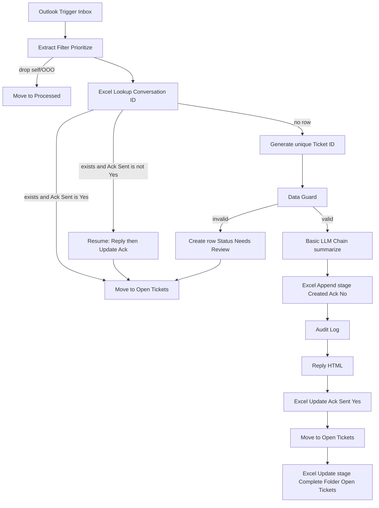

# Fault-Tolerant IT Ticketing Upgrades

## Locked decisions

- **Baseline:** [scripts/_build_workflows.py](scripts/_build_workflows.py) → [workflows/IT_Ticketing_Main.json](workflows/IT_Ticketing_Main.json) + Error Notifier (Outlook Trigger, **concurrency = 1**).
- **Locks:** Do **not** reintroduce Excel `WorkflowLocks`. Main already avoids them; ClaudeFlows remains reference-only.
- **Folders (mailbox root, flat):** `Inbox` | `Open Tickets` | `Processed` only.
- **AI:** Basic LLM Chain + **OpenRouter Chat Model** in the exported JSON (swap to Groq Chat Model in UI if preferred). Credentials left empty for you to attach.
- **Excel SoT:** [scripts/generate_it_support_workbook.py](scripts/generate_it_support_workbook.py) → regenerate [assets/IT Support Tickets.xlsx](assets/IT%20Support%20Tickets.xlsx) (and NGI copy if that script path is still used).

## Problem → design

### 1. Fault tolerance (highest priority)

Add ticket columns (appended **before** formula columns so Status/Priority letter refs stay stable):

| Column | Purpose |
|--------|---------|
| `Processing Stage` | `Created` → `Acked` → `Complete` (or `NeedsReview`) |
| `Ack Sent` | `No` / `Yes` |
| `AI Issue Summary` | From LLM |
| `AI Priority` | Low/Medium/High/Critical |
| `AI Scope` | Affected user/app/device |

**Resume rule** after Conversation ID hit:

- `Ack Sent != Yes` → **do not** create a second ticket; rebuild reply payload from the existing row + current message → Reply → Excel **table update** (`columnToMatchOn` = `Ticket ID` or `Conversation ID`) set `Ack Sent=Yes`, `Processing Stage=Acked` → move to Open Tickets → update `Processing Stage=Complete`, `Folder=Open Tickets`.
- `Ack Sent=Yes` → move-only (idempotent follow-up / stuck-in-Inbox cleanup).

**Create path order** (documented + enforced in builder):

1. Append row with `Ack Sent=No`, `Processing Stage=Created`, AI fields filled (or blank if AI failed).
2. Audit (continueOnFail).
3. Reply.
4. Update ack flags.
5. Move.
6. Update stage/folder Complete.

Uses Microsoft Excel **table `update`** with `columnToMatchOn` (same pattern already proven in ClaudeFlows Core Processor; Graph-backed). Official Table docs list append/lookup; update is available on the node (`typeVersion` 2.2) and is required for stage recovery.

Keep workflow **concurrency = 1** (official isolation substitute for locks).

### 2. Locking

No lock sheet/columns in the workbook generator. Sticky notes / guide will state: concurrent safety = n8n concurrency 1 + Conversation ID + Ack Sent resume. Ignore ClaudeFlows lock design.

### 3. Three-folder Outlook logic

| Event | Folder |
|-------|--------|
| New mail | Inbox (trigger) |
| Dropped (self-sent / auto-reply) | **Processed** |
| Invalid data | **Open Tickets** (Excel `Status=Needs Review`, stage `NeedsReview`) |
| New ticket success / follow-up / ack-resume | **Open Tickets** |
| Closed (manual / future close flow) | **Processed** |

Remove nodes/refs for `Filtered`, `NeedsReview`, and nested `Processed/Open Tickets`. Update folder placeholders in `_build_workflows.py` so Move nodes target reselectable **Open Tickets** and **Processed** IDs.

Add `Needs Review` to workbook `STATUSES` + dropdown list.

### 4. AI summarization

Insert after Data Guard (valid path), before Excel create:

- **Basic LLM Chain** ([docs](https://docs.n8n.io/integrations/builtin/cluster-nodes/root-nodes/n8n-nodes-langchain.chainllm/)) — prompt from [Prompts/Enhancing Prompt.md](Prompts/Enhancing%20Prompt.md); `Require Specific Output Format` on.
- **Structured Output Parser** — JSON example: `{ "issue": "", "priority": "Medium", "scope": "" }`.
- **OpenRouter Chat Model** sub-node ([docs](https://docs.n8n.io/integrations/builtin/cluster-nodes/sub-nodes/n8n-nodes-langchain.lmchatopenrouter/)) — credential placeholder; prefer a free/cheap model from the account dropdown after you attach the key.
- `continueOnFail: true` on the chain; Code node merges defaults (`issue` = truncated body, `priority` = keyword priority, `scope` = requester) if AI fails so ticketing never blocks on LLM.

Map parser fields → Excel `AI Issue Summary` / `AI Priority` / `AI Scope`. Keyword `Priority` column remains for ops; AI Priority is advisory.

## Excel script changes ([generate_it_support_workbook.py](scripts/generate_it_support_workbook.py))

1. Extend `TICKET_COLUMNS` with the five new fields **immediately before** `Ticket Age Days` / `SLA Remaining Hours`.
2. Recalculate formula helpers by **column index from `TICKET_COLUMNS`** (not hard-coded `Z`/`AA`) so age/SLA/dashboard/conditional formatting cannot drift into `#REF!`.
3. Update sample rows, wrap columns for AI summary, Configuration `Workbook Version` → `2.0`, Folder samples → `Open Tickets` / `Processed`.
4. Default `--output` to `assets/IT Support Tickets.xlsx`.
5. After `generate()`, add a small verifier: every Dashboard/Reports/Tickets formula’s sheet refs resolve to existing headers; named ranges present; table `ITTickets`/`AuditLog` refs match used range; print a PASS/FAIL summary (catches letter-shift bugs before upload).

## Workflow builder changes ([_build_workflows.py](scripts/_build_workflows.py))

1. Folder constants: only Processed + Open Tickets; drop Filtered/NeedsReview.
2. Conversation-ID branch: IF on `Ack Sent` → resume vs move-only.
3. Valid path: AI chain + parse merge → create row includes new columns → audit → reply → Excel update ack → move → Excel update complete.
4. Invalid path: append Needs Review row (optional minimal) + move Open Tickets (so mail is not lost in Inbox).
5. Dropped path: move Processed.
6. Sticky notes + emit to `workflows/IT_Ticketing_Main.json` (and Error Notifier unchanged unless setup text needs folder list).
7. Update [WORKFLOW_GUIDE.md](WORKFLOW_GUIDE.md) folder table, recovery matrix, AI section, setup checklist.

## Post-generation verification (mandatory)

1. Run workbook generator; confirm verifier PASS.
2. Open regenerated xlsx (openpyxl): assert headers, no broken defined names, Dashboard formulas point at correct letters for Status/Priority/Age/SLA.
3. Grep emitted Main JSON for stale folder names (`Filtered`, `NeedsReview`, `Processed/Open Tickets`) and missing new column names.
4. Spot-check Excel update nodes use `columnToMatchOn` + spaced headers matching the generator (`Ticket ID`, `Ack Sent`, etc.).

## Manual steps for you (after implementation — API keys)

Documented at delivery time, also in guide:

**OpenRouter (default in JSON)**

1. Create key at [openrouter.ai/keys](https://openrouter.ai/keys).
2. n8n → Credentials → **OpenRouter** → paste API key ([official creds](https://docs.n8n.io/integrations/builtin/credentials/openrouter/)).
3. Open Main → **OpenRouter Chat Model** → select credential → pick a free/cheap model from the list.
4. Activate workflow; send a test email; confirm AI columns populate.

**Groq (optional swap)**

1. Create key in [Groq console](https://console.groq.com/).
2. n8n → Credentials → **Groq** ([docs](https://docs.n8n.io/integrations/builtin/credentials/groq/)).
3. Replace OpenRouter Chat Model sub-node with **Groq Chat Model**, attach credential, pick model.
4. Leave Basic LLM Chain + Structured Output Parser unchanged.

Also: create mailbox folders `Open Tickets` and `Processed` if missing; reselect every Move/Excel node after uploading the new workbook (tenant IDs).
