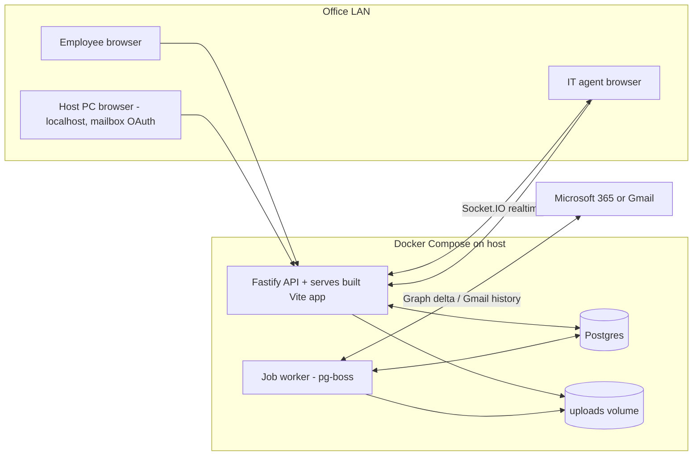
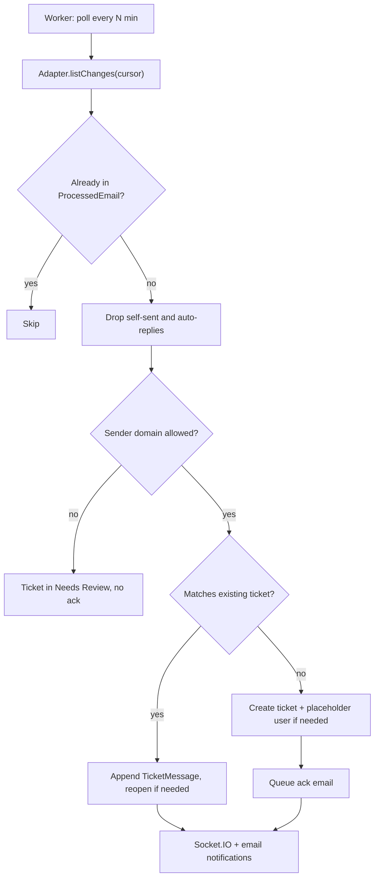

# Local IT Helpdesk App (Vite + Node + Postgres)

## Decisions captured
- Hosted on one office machine with Docker Compose; employees use `http://<host-ip>:<port>` on the LAN.
- Accounts are created by an admin only (no self sign-up). The admin sets a temporary password and the user must change it at first login. Accounts are allowed only for domains on the admin's allow-list, with optional subdomain matching.
- Roles: Employee, IT Agent, Admin. Several agents; tickets can be assigned and reassigned.
- Stack: React + TypeScript + Tailwind + shadcn/ui on Vite; Node.js + TypeScript (Fastify) API; Prisma; Postgres.
- One active support mailbox in v1, but the schema allows several. Microsoft 365 is built first, then Gmail, with a provider-adapter interface so IMAP/SMTP can be added later.
- Email and chat are two-way: agent replies go out by email, and email replies on the thread show up in the ticket chat.
- Emails from allowed-domain senders without an account create the ticket plus a placeholder (inactive) employee record. Emails from outside the allowed domains go to a Needs Review queue with no auto-reply.
- AI summary and priority suggestion are optional, switched on in admin settings, with a pluggable provider (OpenRouter or Groq, as in n8n).
- The ticket ID format is configurable in admin settings.
- Notifications in v1: real-time in-app updates and email. Teams/Slack comes later.
- The app is independent of n8n; n8n is retired after sign-off.

## Key constraint found in research (affects setup)
- Microsoft Entra accepts plain `http` redirect URIs only for `localhost`; every other address must use HTTPS ([Microsoft docs](https://learn.microsoft.com/en-us/entra/identity-platform/reply-url)). Google also rejects raw IP addresses as redirect URIs.
- Decision: the admin clicks **Connect mailbox** only on the host machine at `http://localhost:<port>`. Everyone else uses the LAN URL. The UI shows a hint if "Connect" is opened from a non-localhost address.
- Gmail: an External OAuth app in "Testing" status loses its refresh token after 7 days ([Google docs](https://support.google.com/cloud/answer/15549945)). If the account is Google Workspace, mark the OAuth app **Internal** (no 7-day expiry, no verification). For personal Gmail, the app warns the admin and shows "reconnect needed". This is resolved when we reach the Gmail phase.

## Architecture

- One Node image runs two processes, `api` and `worker`, sharing code. pg-boss (a job queue stored in Postgres) handles mailbox polling, outbound email, AI calls and cleanup, so no Redis is needed.
- Socket.IO handles live updates, with rooms per ticket and an agents' queue room.
- Attachments are stored on a Docker volume, with path, size, MIME type and sha256 recorded in Postgres.

## Repo layout (new folder, n8n files untouched)
- `helpdesk/apps/web`: Vite + React (TanStack Router + TanStack Query, react-hook-form + zod)
- `helpdesk/apps/api`: Fastify routes, auth, Socket.IO, and the worker entry point
- `helpdesk/packages/shared`: zod schemas and types shared by web and api
- `helpdesk/packages/mail`: provider adapters, body cleaner, threading logic
- `helpdesk/prisma/schema.prisma`, `helpdesk/docker-compose.yml`, `helpdesk/.env.example` (placeholder values only)

## Data model (core tables)
- `User` (email, name, role, passwordHash argon2id, mustChangePassword, status active/inactive/placeholder, department), `Session` (server-side, httpOnly cookie)
- `AllowedDomain` (domain, includeSubdomains)
- `Category`, `Priority` (admin-configurable lists)
- `Ticket` (ticketNumber, subject, description, categoryId, priority, status, requesterId, assigneeId, source web/email, needsReview reason, aiSummary/aiPriority, resolutionNotes, closedAt)
- `TicketMessage` (ticketId, authorId, kind public/internal_note/system, bodyHtml/bodyText, source web/email, emailMessageId)
- `Attachment` (ticketId/messageId, file metadata, inline flag)
- `Mailbox` (provider, address, encrypted tokens, syncCursor, status, lastSyncAt, lastError), `EmailThreadLink` (mailboxId, providerThreadId, ticketId), `ProcessedEmail` (providerMessageId and internetMessageId unique, used for idempotency)
- `OutboundEmail` (queued/sent/failed, retries, providerMessageId)
- `TicketIdCounter` (period key, last value; incremented atomically with `UPDATE ... RETURNING`)
- `Setting` (key/value JSON: ID format, templates, AI, limits), `AuditLog`

Statuses: `New`, `Open`, `In Progress`, `Waiting on Requester`, `Resolved`, `Closed`, plus a `Needs Review` queue.

## Features by role
- **Employee**: log in, forced password change, create ticket (category, priority, subject, description, image attachments with size/count limits), list own tickets, chat on own tickets, see status, confirm resolution.
- **IT Agent**: queue with filters (status, priority, assignee, unassigned, Needs Review), claim/assign, change status/priority/category, public reply or internal note, attachments, close with resolution notes, live updates.
- **Admin**: everything agents can do, plus allowed domains, users (create, temporary password, role, deactivate, reset, convert placeholder to active), categories/priorities, ticket ID format (tokens such as `{PREFIX}-{YYYY}{MM}{DD}-{SEQ:4}`, preview), email templates (ack, reply, closed), attachment limits, AI settings, mailbox connect/disconnect/sync status/manual sync/error log, audit log.

## Email sync design (ports the n8n logic)

- **Adapter interface** (`packages/mail`): `getAuthUrl`, `handleCallback`, `refreshToken`, `listChanges(cursor)`, `getMessage`, `getAttachments`, `sendReply(threadRef, html, attachments)`, `sendNew(to, subject, html)`, plus optional `moveToFolder`.
- **Microsoft**: MSAL Node confidential client with the authorization-code flow. Delegated scopes: `offline_access Mail.ReadWrite Mail.Send User.Read`. Inbox sync uses [message delta](https://learn.microsoft.com/en-us/graph/delta-query-messages) with `changeType=created`; the `deltaLink` is stored as the cursor, and a `410 Gone` response triggers a resync limited to recent mail. Replies use `createReply` then `send`, so HTML and attachments go out on the same conversation.
- **Gmail** (phase 2): the `googleapis` client, cursor from `users.history.list` via `historyId`, with a full resync if the history ID has expired. Replies are sent with `threadId` plus `In-Reply-To`/`References` headers. Exact scopes (`gmail.modify` / `gmail.send`) to be confirmed against Google docs at implementation time.
- **IMAP later**: the same interface backed by imapflow + nodemailer (XOAUTH2 where available).
- **Thread matching** (in this order): provider thread ID (Graph `conversationId` / Gmail `threadId`), then the `[TICKET-ID]` token that outbound subjects always include, then `In-Reply-To`/`References` matched against stored Message-IDs.
- **Body cleaning**: port the `Extract & Filter Email Data` Code node from [workflows/IT_Ticketing_Scheduled.json](workflows/IT_Ticketing_Scheduled.json), plus the signature, quote and image stripping from [.cursor/plans/strip_signatures_and_images_6068de0b.plan.md](.cursor/plans/strip_signatures_and_images_6068de0b.plan.md), into a tested `cleanBody()`. Also port keyword priority detection and the auto-reply/self-sent filters.
- **Attachments from email**: store regular attachments; skip small inline images (logos, signatures) below a configurable size threshold.
- **Reliability**: `ProcessedEmail` unique keys make re-polling safe. Outbound mail goes through an `OutboundEmail` queue with retries. Tokens are encrypted with AES-256-GCM using `APP_ENCRYPTION_KEY` from env. Sync errors appear on the admin Mailbox page.
- **Cutover**: a "shadow mode" setting syncs and creates tickets without sending acks, so results can be compared while n8n still runs. Never let both send acks on the same mailbox.

## Security basics
- argon2id password hashes, login rate limiting with lockout, secure httpOnly SameSite cookies, CSRF token for state-changing requests, role checks on every route, attachment MIME/size checks with files served only through authorised routes, and an audit log of admin actions.
- Only LAN exposure; the plan includes a Windows Firewall rule for the app port and scheduled `pg_dump` backups to a host folder.

## Build phases
1. Scaffold the monorepo, Docker Compose (Postgres + app), Prisma schema/migrations, and a seed admin from env.
2. Auth: login, sessions, forced password change, admin user and domain management.
3. Tickets: employee portal, creation with images, configurable ticket ID generator, categories/priorities.
4. Agent workspace: queue, assignment, status flow, chat with internal notes, Socket.IO live updates.
5. Microsoft mailbox: OAuth connect on localhost, outbound queue, ack/reply/closed templates, email notifications.
6. Microsoft inbound sync: delta polling, cleaning, threading, Needs Review, placeholder users, shadow mode.
7. Gmail adapter (Workspace Internal recommended).
8. Optional AI summary and priority via OpenRouter/Groq, never blocking ticket creation.
9. Hardening: backups, LAN/firewall guide, README setup (Entra and Google app registration steps), cutover checklist from n8n.

## Verification
- Vitest unit tests: `cleanBody` (using the sample cases listed in the strip-signatures plan), thread matching, ticket ID formatting and concurrency, domain/subdomain matching.
- Adapter tests with recorded Graph/Gmail JSON fixtures; one manual end-to-end test against a real test mailbox.
- Playwright end-to-end tests: admin creates user, employee changes password and raises a ticket with an image, agent replies, the employee sees it live, the agent closes it.
- Email round trip: send an email, check ticket and ack; reply on the thread, check it appends with no new ticket; reply from the app, check it arrives in the thread.

## Open items to settle later (not blocking phases 1-6)
- Gmail account type (Workspace vs personal), at phase 7.
- Teams/Slack notifications, SLA timers, and reopen rules (default: an email reply within 7 days of closing reopens the ticket, after that it creates a new one), which can be adjusted.