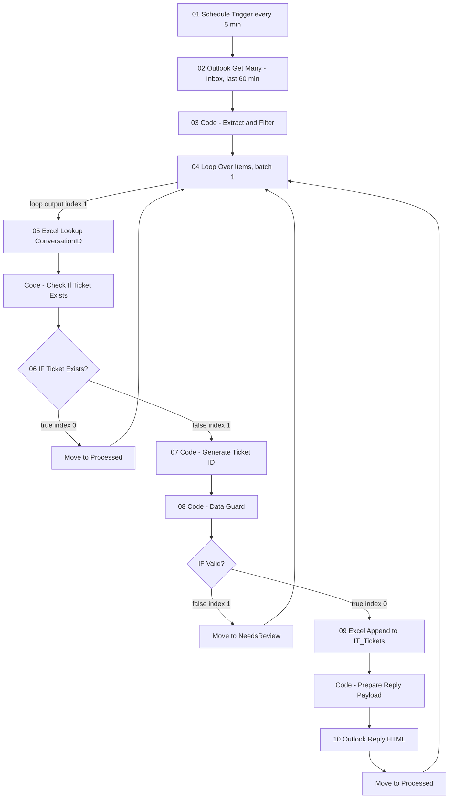

# Scheduled IT Ticketing Workflow (diagram v3)

## Output
- New file: `workflows/IT_Ticketing_Scheduled.json` (importable into n8n 2.23.4)
- Base: [workflows/v2 - current working/IT Support Ticketing - v2.0.json](workflows/v2%20-%20current%20working/IT%20Support%20Ticketing%20-%20v2.0.json). It already matches about 80% of the diagram, so reuse its node shapes, credential names, Excel workbook/table references, and the HTML reply template.
- Leave the current Outlook-Trigger flow in `workflows/IT_Ticketing_Main.json` untouched.

## Flow

Port ordering was checked against the official docs. In Loop Over Items v3, output 0 is `done` and output 1 is `loop`, as shown in the docs example connections `[[], [next]]`. In IF v2.2, output 0 is `true` and output 1 is `false`. The `done` output stays unconnected.

## Node-by-node changes vs v2.0
1. **Schedule Trigger** (`scheduleTrigger` 1.2): set `minutesInterval: 5` explicitly. v2.0 relied on the default.
2. **Get Inbox Messages** (`microsoftOutlook` 2, message `getAll`):
   - Limit the fetch to the **Inbox** folder and messages **received after now minus 60 minutes**, using the node's Filters. v2.0 fetched the whole mailbox, which includes Sent Items and Processed, so moved mail could be picked up and processed again.
   - Keep `output: raw` so `conversationId`, `internetMessageId`, and `body` are available.
3. **Extract & Filter** (Code): reuse the v2.0 logic as-is. It already drops emails older than 60 minutes, self-sent emails, and auto-replies, and it sets keyword priority. Keep the 60-minute check as a second safeguard.
4. **Loop Over Items** (`splitInBatches` 3): batch size 1.
5. **Excel Lookup** (`microsoftExcel` 2.2, table `lookup`, column `ConversationID`): keep `alwaysOutputData: true` so a "not found" result still reaches the next step.
6. **Check / IF Ticket Exists**: keep as in v2.0. The true branch moves the email to Processed and returns to the loop, which is the diagram's "Ignore & Continue".
7. **Generate Ticket ID** (Code): use the exact format `NGI-YYYYMMDD-HHMMSS` built from `$now` (Luxon) in the workflow timezone (`Asia/Kolkata`). This drops v2.0's random suffix.
   - Same-second collision guard: store the last issued ID in `$getWorkflowStaticData('global')`. If the new ID matches it, add 1 second.
   - Static data only persists in production (active) runs. Manual test runs don't need the guard.
8. **Data Guard** (Code + IF): reuse the v2.0 checks and add a regex check `^NGI-\d{8}-\d{6}$`. If validation fails, move the email to NeedsReview and return to the loop.
9. **Excel Append** to `IT_Tickets`. Use the minimal column set, which already matches the v2.0 table: `TicketID`, `CreatedDate`, `RequesterName`, `RequesterEmail`, `Subject`, `Description`, `Priority`, `Status` (always `New`), `ConversationID`, `InternetMessageId`.
   - Fix: v2.0 wrote the Graph `messageId` into `InternetMessageId`. The new flow writes the real `internetMessageId` there.
10. **Prepare Reply Payload + Outlook Reply**:
    - Fix: read ticket data with `$('Generate Ticket ID').item` instead of `.first()`, so each loop pass uses its own item.
    - Reuse the v2.0 HTML template and confirm the reply sends the body as HTML.
    - Then move the email to Processed and return to the loop.

## Workflow settings in JSON
- `executionOrder: "v1"`, `timezone: "Asia/Kolkata"`, and save both successful and failed executions.
- Note for setup: activate only one scheduled copy. If a run takes longer than 5 minutes, two runs could overlap and create duplicates.

## Placeholders to reselect after import (sticky note in the JSON)
- Outlook credential, Excel credential, workbook/sheet/`IT_Tickets` table
- Folder IDs for `Processed` and `NeedsReview`, which are tenant-specific. Keep the v2.0 cached IDs as defaults.
- Optional: attach the existing [workflows/IT_Ticketing_Error_Notifier.json](workflows/IT_Ticketing_Error_Notifier.json) as the Error Workflow.

## Uncertain points to verify in the n8n 2.23.4 editor after import
- The exact parameter keys for the Outlook v2 Get Many filters (received-after date and folder) and the reply body type. The official docs page lists the operations but not the parameter schema. If they differ, reselect these fields in the UI; this doesn't change the flow structure.

## Validation
- Parse the JSON, confirm every connection target exists, and confirm each loop-back points to `Loop Over Items` input 0.
- Manual test: send an email, then confirm a row appears in `IT_Tickets`, the HTML ack arrives, and the email moves to Processed. Reply on the same thread and confirm no new row is created and the email moves to Processed.