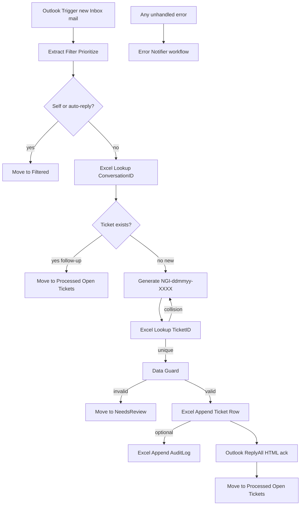

# Single Production IT Ticketing Workflow

## Decisions locked in

| Decision | Choice | Why |
|----------|--------|-----|
| Scope | Full [TicketingPrompt.md](TicketingPrompt.md) for v1 | Your choice C |
| Trigger | **Microsoft Outlook Trigger** (`messageReceived`) | Prompt requires it; most reliable *event* path on Graph. Reliability comes from **idempotency + move-out-of-Inbox + concurrency=1**, not a second poller |
| Workflow count | **1 main + 1 error** | n8n’s Error Trigger *must* be a separate workflow; business logic stays in one linear flow |
| Concurrency | Workflow setting **`concurrency = 1`** | Replaces ClaudeFlows’ Excel `WorkflowLocks` (~15 nodes). Serial executions = no Excel race / mixed ticket data |
| Skip from ClaudeFlows | Sub-workflow Core, hourly reconciliation, lock loops | Those made debugging hard; not needed with Outlook Trigger + folders + ConversationID dedupe |

**Webhook caveat (honest):** Graph/n8n Outlook subscriptions can rarely miss an event. Mitigations in this design: processed mail leaves Inbox; ConversationID lookup prevents duplicates; Error Notifier alerts on failures. A schedule “reconciliation” backup is **out of v1** because the prompt forbids Schedule/Cron as the workflow start—and you asked for one understandable system. Revisit only if production proves misses.

---

## Target architecture



One execution = one email. No `SplitInBatches` loop (unlike v2.0’s poll-all-inbox design).

---

## How it works (debug map)

### 1. Trigger — Outlook only
- Watches IT Support mailbox **Inbox** (or `Inbox/New Requests` if you create that subfolder and route mail there).
- Each new message starts **one** execution with Graph message fields (`id`, `conversationId`, `internetMessageId`, `from`, `ccRecipients`, `subject`, `body`, etc.).

### 2. Extract / filter (Code node)
Keep the proven filters from [IT Support Ticketing - v2.0.json](IT%20Support%20Ticketing%20-%20v2.0.json):
- Drop self-sent (`itsupport@…`) and auto-replies (OOO, undeliverable, etc.) → move to **Filtered** (prevents ack loops).
- Sanitize body, detect priority keywords.
- Capture **CC list** as comma-separated emails (v2.0 missed this; prompt requires it).
- Output a flat payload: `messageId`, `conversationId`, `internetMessageId`, sender, CCs, subject, body, priority.

### 3. New vs follow-up
- **Primary key:** Excel lookup on `ConversationID` (same approach as working v2.0).
- If row exists → **follow-up**: do **not** create a ticket or send another ack; move mail to `Processed/Open Tickets` and stop.
- Optional soft check: subject contains `NGI-…` ticket ID (belt-and-suspenders; ConversationID remains source of truth).

### 4. Ticket ID — `NGI-<ddmmyy>-<XXXX>`
- Fix v2.0’s wrong format (`NGI-YYYYMMDD-HHMMSS-XXXX`).
- Generate random A–Z0–9 suffix; **lookup TicketID in Excel**; on hit, regenerate (small retry loop, max ~5). With `concurrency=1`, collisions are rare and safe.

### 5. Create row → ReplyAll → Move
- Append full ticket row to Excel table `IT_Tickets`.
- **ReplyAll** (not plain Reply) so original CCs stay on the thread.
- Move conversation message to `Processed/Open Tickets`.
- Order matters for partial failure: **Excel first, then reply, then move**. If reply fails, ticket still exists (idempotent on retry via ConversationID). If move fails, Error Notifier fires; next same-conversation mail still dedupes.

### 6. Error Notifier (second tiny workflow)
- Error Trigger → format details → email admin.
- Wire Main workflow Settings → Error Workflow → this notifier.
- Covers Outlook/Excel timeouts and node failures (prompt §10).

---

## Outlook folder strategy (prerequisites)

Create under the IT Support mailbox:

```text
Inbox
Filtered
NeedsReview
Processed
 ├── Open Tickets
 ├── Pending
 └── Closed
Archive
 └── Archived Tickets
```

| Folder | Who moves mail | Purpose |
|--------|----------------|---------|
| Inbox | Trigger source | New requests only |
| Filtered | Workflow | Self/auto-reply drops |
| NeedsReview | Workflow | Invalid/missing data |
| Processed/Open Tickets | Workflow | Created + follow-ups |
| Pending / Closed / Archive | Humans (manual or later automation) | Ops lifecycle |

After success, mail leaves Inbox → Outlook Trigger will not re-fire on the same message.

---

## Excel workbook (Python deliverable)

Generate via `openpyxl` script (prompt Option B) producing `IT_Support_Tickets.xlsx`:

**Sheets**
- **Tickets** — Excel Table `IT_Tickets` with columns from prompt §8 (TicketID, Created Date/Time, Requester, CC, Subject, Body, Priority, Category, Department, Status, Assigned Engineer, ConversationID, InternetMessageID, ConversationIndex, Folder, Last Updated, Closed Date, Resolution Notes, Internal Remarks, plus MessageId for Graph reply).
- **Configuration** — company prefix, SLA hours, admin email, expected response text.
- **Categories / Users** — lists for dropdowns.
- **Dashboard** — counts (Open/Closed/by priority) via formulas + charts.
- **Audit Log** — table `AuditLog` (timestamp, event, ticketId, conversationId, detail) — written on create / invalid / drop if we keep thin audit writes; no lock sheet.
- **Reports** — monthly formula stubs.

**Validation & formatting:** named ranges + dropdowns for Status, Priority, Category, Department, Assigned Engineer, etc.; conditional formatting for Open/In Progress/Pending/Closed and High priority (prompt §14–15).

Workflow nodes will re-bind workbook/worksheet/table IDs after upload to OneDrive/SharePoint (IDs are tenant-specific, same as v2.0).

---

## Main workflow node list (~18–22 nodes, linear)

Reuse credentials/names from v2.0 where possible (`IT Support Microsoft Outlook`, `IT Support NGI Microsoft Excel`).

1. Outlook Trigger — New Mail  
2. Extract, Filter & Prioritize (Code)  
3. IF — Should Process?  
4. Move → Filtered *(false branch)*  
5. Excel — Lookup ConversationID (`alwaysOutputData: true`)  
6. Check If Ticket Exists (Code)  
7. IF — Ticket Already Exists?  
8. Move → Processed/Open Tickets *(follow-up)*  
9. Generate Ticket ID (Code) — `NGI-ddmmyy-XXXX`  
10. Excel — Lookup TicketID  
11. IF — ID Collision? → loop back to Generate (max attempts in Code)  
12. Data Guard (Code)  
13. IF — Valid?  
14. Move → NeedsReview *(invalid)*  
15. Excel — Create Ticket Row  
16. Excel — Audit Log Created *(optional thin write)*  
17. Prepare Reply Payload (Code) — preserve messageId/CCs/ticketId  
18. ReplyAll HTML ack  
19. Move → Processed/Open Tickets  
20. Sticky notes: Setup + Debug map  

**Explicitly not included:** WorkflowLocks, Execute Workflow, Schedule reconciliation, SplitInBatches inbox poll.

**n8n settings on Main:** Error Workflow = Error Notifier; concurrency = 1; save execution data on error/success for debugging.

---

## Fixes vs current v2.0 failures

| Likely failure mode in v2.0 | Fix in new design |
|-----------------------------|-------------------|
| Schedule poll + 1-hour filter misses or double-sees mail | Event trigger; move out of Inbox |
| Wrong ticket ID format | Match prompt `NGI-ddmmyy-XXXX` |
| No CC on ack | ReplyAll + store CC column |
| Parallel Excel writes if poll returns many | One email per execution + concurrency 1 |
| Fragile `$('Loop Through Emails')` context | No batch loop; keep payload in `$json` / one named Code node |
| Silent failures | Error Notifier + NeedsReview path |

---

## Deliverables (after you approve this plan)

1. **[new]** Importable `IT_Ticketing_Main.json` — the single business workflow  
2. **[new]** Importable `IT_Ticketing_Error_Notifier.json`  
3. **[new]** `generate_it_support_workbook.py` + generated workbook structure  
4. **[new]** `WORKFLOW_GUIDE.md` — prerequisites, node-by-node, expressions, how to debug each failure mode, security notes  
5. ClaudeFlows kept as reference only (not used)

---

## Prerequisites (you / ops before activate)

1. n8n with Microsoft Outlook OAuth2 + Microsoft Excel OAuth2 on the IT Support account  
2. Outlook Trigger requires n8n reachable by Microsoft (cloud n8n or public webhook URL)  
3. Create Outlook folders listed above; reselect folder IDs in Move nodes after import  
4. Upload generated Excel to OneDrive/SharePoint; create Tables if script didn’t; reselect workbook/sheet/table in Excel nodes  
5. Set Main → Error Workflow → Error Notifier; set concurrency = 1  
6. Confirm support mailbox address used in self-send filter  
7. Admin alert recipient for Error Notifier  

---

## Security & ops (prompt §19)

- OAuth credentials only (no embedded secrets in JSON)  
- Do not log full email bodies to external systems beyond Excel/AuditLog  
- Restrict Excel file permissions to IT Support group  
- Ack email: professional HTML; expected response text from Config sheet or fixed copy in Reply node
