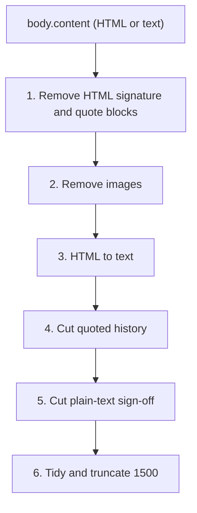

# Strip signatures, quoted replies and images from the ticket Description

## Where
Only the `Extract & Filter Email Data` Code node in [workflows/IT_Ticketing_Scheduled.json](workflows/IT_Ticketing_Scheduled.json), section `// --- 4. Sanitize body (FR-5) ---`. Nothing else changes; `bodyPreview` keeps feeding Excel `Description` and Data Guard.

## Root issue found
The code reads `item.bodyPreview || item.body?.content`. `bodyPreview` is Graph's plain-text preview, so the HTML version is never used. That makes HTML-based signature removal impossible, and it also keeps text such as `[cid:image001.png@...]` image placeholders. Switch to `item.body?.content` (available because the fetch node uses `output: raw`), falling back to `bodyPreview` only if the full body is missing.

## Cleaning pipeline (new helper `cleanBody(html, isHtml)`)

1. **HTML signature and quote blocks**, removed before tags are stripped: elements with `id` matching `Signature`, `x_Signature`, `ms-outlook-mobile-signature`, `divRplyFwdMsg`, `appendonsend`; classes `gmail_signature`, `gmail_quote`; `<blockquote>`; and everything after an Outlook `
` or `
`. Since nested tags make a full regex match unreliable, cut from the marker's opening tag to the end of the document. Signatures and quoted history always come after the new message.
2. **Images**: drop `` tags (covers `cid:` inline and `data:` base64 images), and after converting to text, drop `[cid:...]`, `[image: ...]`, `[image]` placeholders.
3. **HTML to text**: keep the existing style/script/tag stripping. Before stripping, turn ` `, `
` and `
` into newlines so line-based steps work, and decode common entities (`&nbsp;`, `&amp;`, `&lt;`, `&gt;`, `&quot;`, `&#39;`).
4. **Quoted history (text)**: cut at the first line matching `^From:\s.+` when followed within 4 lines by `Sent:` or `Date:`, at `^On .+ wrote:$`, at `^-{2,}\s*Original Message\s*-{2,}`, or at `^_{10,}$` (Outlook's separator).
5. **Plain-text sign-off (heuristic)**: cut at the first line that is only a sign-off: `--`, `Regards`, `Best regards`, `Kind regards`, `Warm regards`, `Thanks`, `Thank you`, `Thanks & regards`, `Cheers`, `Sincerely`, `Sent from my iPhone/Android/Outlook...`, `Get Outlook for ...`, optionally followed by `,` or `.`. Safety rules:
   - The line must be a sign-off on its own (case-insensitive, at most about 40 characters), so "Thanks for checking the VPN issue" is kept.
   - Only cut if at least one non-empty line remains above it. Otherwise keep the text, so an email that is only "Thanks" doesn't end up empty.
6. **Tidy**: keep the existing trim, blank-line collapse, and 1500-character truncation. If cleaning produces an empty string, fall back to the cleaned `bodyPreview` and then to `(no content)` as today.

## Priority detection
`detectPriority(subject, cleanedBody)` keeps using the cleaned body. As a result, words in signatures or quoted history (e.g. "urgent" in an old thread) no longer affect priority, which is intended.

## Validation
- Run the updated `jsCode` with Node against a few sample bodies: an Outlook web HTML email with `
` and an inline `cid:` image; an Outlook desktop reply with `divRplyFwdMsg` and history; a Gmail HTML reply with `gmail_signature` and `gmail_quote`; a plain-text "Regards, Name, Phone" email; a mobile "Sent from my iPhone" email; and a one-word "Thanks" email. Confirm each output contains only the new message.
- Re-parse the workflow JSON and re-check connections, which stay unchanged.
- Known limit, to tell the user: a plain-text signature with no sign-off line (just a name and phone number) is not detectable and stays in the Description.